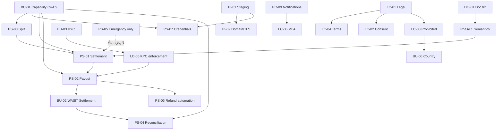

# WASIT BUSINESS GLOBAL — PILOT EXECUTION PLAN (v3.2 — Automated-First · Financial Semantics Corrected)

> **نوع الوثيقة**: تخطيط/تصميم فقط. **لا تنفيذ.** لا كود، لا migrations، لا DB changes، لا reset/drop/push،
> لا تغيير في Commission Policy ولا Payment Kernel (التعديلات مذكورة كـ**مقترح** لا كمنفَّذ).
> **القرار المعماري الحاكم (v3)**: **WASIT نظام مالي آلي من الأساس.** لا Staff في المسار المالي الطبيعي.
> **مرجع**: `docs/MASTER_GAP_AUDIT.md` · `docs/MANUAL_VS_AUTOMATED_FINANCIAL_ANALYSIS.md` ·
> `docs/PAYMENT_SETTLEMENT_AUDIT.md` · `docs/PAYMENT_PROVIDER_IPAY_COMPATIBILITY_AUDIT.md` ·
> `docs/PRODUCTION_GAP_LIST.md` · `CHECKPOINT.md` · `AGENTS.md` · `docs/PROJECT_BASELINE.md`.
> **v3.2 (المراجعة الدلالية النهائية)**: فصل `WASIT Commission Earned` عن `Settlement Received`، وتعريف
> `PAID/PENDING/SETTLED` مطابقًا للـschema، **جدول الحالة النهائية لكل مجال** (Payment=`PAID` · Ledger=`SETTLED` ·
> Payout=`COMPLETED` · WASIT Receipt=`RECEIVED`)، **قائمة تدقيق Evidence**، ومنع أي افتراض
> (`Payment=Settlement` · `Earned=Received` · `Created=Completed` · `Webhook=Money Moved` · `Staff=Evidence`).
>
> **البديل عن v2**: v2 كان يسمّي PS-05 «Manual Payment Confirmation» ويُدرجه في Phase 1 كمسار أساسي.
> **هذا ملغى**. v3 يجعل الأتمتة المسار الوحيد، وPS-05 **آلية طوارئ** فقط.

---

## 0. الثوابت المالية غير القابلة للتفاوض (Financial Axioms)

| # | البديهة | الأثر على التنفيذ |
| --- | --- | --- |
| **A1** | `Payment ≠ Settlement` | لا يُشتق `settlement_status` من `paymentStatus`. |
| **A2** | `Payment Confirmation ≠ Settlement` | webhook النجاح يثبت الدفع فقط، لا تحرّك المال. |
| **A3** | `Ledger SETTLED ≠ دليل تحرّك مال` | `transaction_ledger.status` يبقى `PENDING` حتى دليل تحويل. |
| **A4** | كل انتقال مالي = **دليل آلي موثوق** من Provider/Bank | ولا يُقبل غير ذلك. |
| **A5** | لا Staff في المسار الطبيعي | أي تدخّل دوري لكل معاملة = خلل تصميم. |
| **A6** | لا `SETTLED` بلا مرجع تحويل | وعلى أي مسار، بما فيه الطوارئ. |
| **A7** | لا Split/Payout نيابة عن المزوّد دون تأكيد + إطار تنظيمي | وإلا = Provider capability gap. |
| **A8** | لا Mock للتكامل الحقيقي | البديل: تعطيل الميزة صراحةً حتى التأكيد. |

> **A7 موضّحة**: إذا كان المزوّد لا يدعم Marketplace Split/Payout/Settlement، فالنظام **لا يعالج ذلك
> بكود داخلي** يجعل WASIT حافظًا لأموال الغير. تُسجَّل الحالة **`Provider capability gap`** ويتوقّف
> اعتماد المسار الآلي، ولا يُبنى «مجمع/موزّع» إلا بعد تحديد المتطلبات القانونية/التنظيمية أولًا.

---

## 0-bis. تصحيح الخلط القائم (مُثبت بالكود) — أساس Phase 1

ثلاثة مواضع في `packages/server/src/modules/payments/service.ts` تعتبر الدفع تسوية:

| الموقع | الكود الحالي | المشكلة | التصحيح المقترح (Phase 1 — غير منفَّذ) |
| --- | --- | --- | --- |
| `service.ts:419-423` | `update(transactionLedger).set({ status: 'SETTLED' })` مع تعليق «Ledger entries settle once the money is confirmed at the provider» | **الدفع يُعامل كتسوية** (خرق A1/A2/A3) | تصبح `status: 'PENDING'` مع حفظ `paymentProvider`؛ الـ`SETTLED` يُكتب **حصرًا** من كاتب التسوية عند دليل تحويل. |
| `service.ts:587` (مسح عكس الاسترداد) | إدراج قيود عكسية بـ`status: 'SETTLED'` | الاسترداد المُبلَّغ من المزوّد قد يكون دليلًا كافيًا، لكن يجب أن يكون **مصدره مُوثَّقًا** لا ضمنيًا | إبقاء `SETTLED` **فقط** عند `REFUND_SUCCEEDED` مُتحقَّقًا؛ وإلا `PENDING`. |
| `service.ts:380` (قيود `reverseCommissionAndFee`) | نفس المنطق | يجب ربطه بدليل الاسترداد لا بالتأكيد | ربط صريح بالحدث الموثَّق. |
| `lib/payments/flouci.ts:129` | `settlementStatus: result.settlement_status ?? null` | **دليل تسوية يُطبَّع ثم لا يُستهلك أبدًا** | يُصبح مدخلًا لكاتب التسوية في Phase 2. |

**الخلاصة**: اليوم الـ`ledger` يقول «مسوّى» عند الدفع، و`orders.settlement_status` يبقى `PENDING` أبدًا.
result: **دلالتان متناقضتان للتسوية في نفس النظام**. Phase 1 تُوحّدهما.

---

## 0-ter. التعريفات المالية المُلزمة (Financial Semantics — v3.2)

> هذا القسم **يعتمد على الـschema الفعلي** (لا تخمينًا) ويُلزم كل تنفيذ. أي عبارة تخالفه تُعدّ خطأ تصميمي.

### أ) معنى حالات الـLedger — مطابقة للـschema

`transaction_ledger.status` يستخدم `settlementStatusEnum` = **`PENDING | PROCESSING | SETTLED | HELD | FAILED`**.
**لا يوجد `PAID` في هذا العمود.** (كلمة «مدفوع» تخصّ `orders.paymentStatus` / `payments.status` / `transactions.status`.)

| الحالة | معناها في `transactionLedger.status` | Evidence المطلوب | ما **لا** تعنيه |
| --- | --- | --- | --- |
| **`PENDING`** | القيد **مُثبت دفتريًا** (amount/direction/currency/payer/beneficiary) لكن **لم يتحرك مال** على مستوى التسوية | كتابة القيد نفسها | ❌ لا يعني فشلًا · ❌ لا يعني أن المال لم يُدفع (الدفع له حالته) |
| **`PROCESSING`** | بدأ مسار تحرّك المال عند المزوّد/البنك | إشارة بدء التسوية من المزوّد | ❌ لا يعني اكتمال التحويل |
| **`SETTLED`** | **ثبت تحرّك المال فعليًا** على مستوى المزوّد/البنك | **دليل تحويل** (settlement event/status API/كشف) | ❌ **لا يعني استلام WASIT لعمولتها** · ❌ لا يُشتق من تأكيد الدفع |
| **`HELD`** | موقوف عمدًا (نزاع/مراجعة مخاطر/شبهة) | قرار احتجاز مُوثَّق | ❌ ليس فشلًا ولا نجاحًا |
| **`FAILED`** | فشل مسار التسوية/الدفع | تقرير فشل من المزوّد/البنك | ❌ لا يُشتق من انتهاء مهلة بلا دليل |

**قاعدة `PAID`**: كلمة «PAID» تعبّر عن **Payment Confirmation** فقط، وتُستخدم حصرًا في:
`paymentIntents.status='SUCCEEDED'` · `payments.status='PAID'` · `transactions.status='PAID'` · `orders.paymentStatus='PAID'`.
**ولا تُستخدم أبدًا كحالة على `transaction_ledger.status`** (لا يوجد `PAID` في `settlementStatusEnum`)،
**ولا كحالة نهائية لـPayout** (حالة Payout النهائية هي `COMPLETED`، انظر §0-ter/ج).

| المجال | حالته النهائية | لا تستخدم فيه |
| --- | --- | --- |
| Payment | `PAID` | — |
| Ledger | `SETTLED` | ❌ `PAID` |
| Settlement (طلب/مزوّد) | `SETTLED` | ❌ `PAID` |
| Payout | `COMPLETED` | ❌ `PAID` · ❌ `SETTLED` |
| WASIT Receipt | `RECEIVED` | ❌ `PAID` · ❌ `SETTLED` |

### ب) فصل عمولة WASIT (ثلاث حالات لا واحدة)

| الحالة | التعبير | متى تتحقق | ما لا يعنيه |
| --- | --- | --- | --- |
| **Commission Earned / Receivable** | استحقاق محاسبي مؤكد | عند **Payment Confirmation** — تُحتسب 40 (20+20) عبر Policy Engine | ❌ لا يعني أن المال عند WASIT |
| **WASIT Settlement Processing** | جارٍ التحصيل/التحويل | عند بدء مسار التسوية من المزوّد | ❌ لا يعني الوصول |
| **WASIT Settlement Received** | **وصل فعليًا** | **دليل مالي فعلي**: كشف/إشعار بنكي أو تأكيد مزوّد بمرجع | — |

**المثال المُلزم (1020 TND):**
```
بعد نجاح Payment:
    WASIT Commission Receivable = 40        ← استحقاق محاسبي
    WASIT Funds Received        = NO        ← لم يصل شيء بعد

بعد وصول دليل التسوية:
    WASIT Settlement           = RECEIVED   ← فقط هنا
```
> **قاعدة**: لا يُستخدم `RECEIVED` ولا `SETTLED` لأي جزء من عمولة WASIT إلا عند وجود **دليل مالي فعلي**
> من Provider/Bank. **Commission Earned ≠ Funds Received.**

### ج) الأزواج الخمسة التي يمنع خلطها

| # | ❌ لا تكافئ | ✅ الصحيح |
| --- | --- | --- |
| 1 | `Payment` = `Settlement` | الدفع حالة تحصيل؛ التسوية تحتاج دليل تحويل مستقلًا |
| 2 | `Payment Confirmation` = `Settlement` | الـwebhook يثبت الدفع فقط |
| 3 | `Commission Earned` = `Funds Received` | الاستحقاق محاسبي؛ الاستلام يحتاج دليلًا بنكيًا |
| 4 | `Payout Created` = `Payout Completed` | الإنشاء `PENDING`؛ الإكمال يحتاج `payoutRef`/تأكيد تحويل |
| 5 | `Webhook Received` = `Money Moved` | استلام الحدث ≠ تحرّك مال؛ الدليل هو محتوى الحدث المُتحقَّق + تأكيد الحالة |

### د) جدول Evidence لكل انتقال مالي نهائي
| الانتقال | إلى | Evidence المطلوب |
| --- | --- | --- |
| Payment Confirmation | `paid` | webhook موقَّع (أو status recheck + تطابق مبلغ) |
| Settlement | `transactionLedger.status = SETTLED` | دليل تحويل من المزوّد/البنك |
| Seller Payout | `payout = COMPLETED` | `payoutRef` + تأكيد تحويل — **`CREATED` ليس إكمالًا** |
| WASIT Receipt | `wasitSettlement = RECEIVED` | دليل استلام بنكي/مزوّد بمرجع |
| Reconciliation | `matched` | مطابقة ثلاثية: Provider ↔ Ledger ↔ Bank |

### هـ) قائمة تدقيق إلزامية: كل انتقال نهائي له Evidence
| ❌ الافتراض الممنوع | ✅ الشرط البديل |
| --- | --- |
| Payment = Settlement | دليل تحويل مستقل لكل قيد `SETTLED` |
| Payment Confirmation = Settlement | الـwebhook يثبت الدفع فقط؛ التسوية حدث آخر |
| `Commission Earned` = `Funds Received` | `EARNED` عند الدفع؛ `RECEIVED` بدليل بنكي فقط |
| `Payout Created` = `Payout Completed` | `CREATED/PENDING` عند الإنشاء؛ `COMPLETED` بـ`payoutRef` |
| `Webhook Received` = `Money Moved` | محتوى الحدث المُتحقَّق + status recheck + تطابق مبلغ |
| `Ledger SETTLED` = استلام WASIT لعمولتها | `SETTLED` = تحرّك مال عند المزوّد؛ الاستلام حالة مستقلة |
| إنشاء سجل = إتمام عملية | كل حالة نهائية تُرفع فقط بمحرّك قرار يقرأ Evidence |
| صلاحية Staff = Evidence | لا دليل، لا انتقال — بلا استثناء |

---

## 1. Executive Summary

النظام الحالي **آلي في التأكيد** (webhook + HMAC + status recheck + idempotency قوية) و**غائب في التسوية
وما بعدها** (لا settlement، لا payout، لا reconciliation، لا retry، ولا إشعار خارجي)، مع **خلط دلالي**
يجعل الدفع = تسوية على مستوى الدفتر.

هذه الخطة **تعيد التصميم آليًا أولًا**: 8 مراحل، تبدأ بـ**تثبيت قدرات المزوّد رسميًا** (Phase 0)،
ثم **تصحيح الدلالات** (Phase 1)، ثم بناء طبقات **Settlement → Payout → WASIT Settlement + Reconciliation →
Refund/Failure/Recovery → Notifications**، وتنتهي بـ**Real-money Pilot Gate** يُشترط فيه أن تكتمل
**معاملة عادية بلا أي تدخّل بشري**.

**PS-05** لم يعد في المسار: يُعاد تصنيفه **`Emergency / Exception / Recovery Mechanism`** بحدود صارمة،
و**لا يكتب `SETTLED` ولا ينشئ Payout ولا يعتبر أموال WASIT مستلمة ولا يتجاوز دليل Provider/Bank**.

**ترتيب الأولويات** (كما طُلب):
```
Phase 0 → Capability & Architecture   (لا افتراض)
Phase 1 → Correct Payment/Ledger Semantics
Phase 2 → Automated Settlement
Phase 3 → Automated Seller Payout
Phase 4 → Automated WASIT Settlement + Reconciliation
Phase 5 → Automated Refund / Failure / Recovery
Phase 6 → Notifications & Operational Automation
Phase 7 → Real-money Pilot Gate
```

---

## 2. المسار المالي الآلي النهائي (من 1020 TND خطوة بخطوة)

**المثال**: `itemsTotal = 1000` · `commission = 40` (4%) · `buyerCommission = 20` (2%) ·
`sellerCommission = 20` (2%) · `grandTotal = 1020` · **لا Wallet**.

| # | الخطوة | الدليل الآلي المطلوب | من ينفّذ | الحالة الناتجة | إشعار |
| --- | --- | --- | --- | --- | --- |
| 1 | إنشاء الطلب | — | المشتري | `orders.paymentStatus=UNPAID`, `settlementStatus=PENDING` | — |
| 2 | Ledger أولي | — | System | `TRANSACTION_VALUE CREDIT 1000` + `COMMISSION(SELLER/BUYER) 20+20` + `PAYMENT_FEE` — **كله `PENDING`** | — |
| 3 | إنشاء Payment Intent | `idempotencyKey` | System→Provider | `intent=PENDING` + `externalRef` | — |
| 4 | دفع المشتري 1020 | صفحة المزوّد | المشتري | — | — |
| 5 | **Payment Confirmation** | **webhook موقَّع** أو status recheck مع مطابقة المبلغ | **Provider** | `intent/payments/transactions/orders = PAID` — **`settlementStatus` يبقى `PENDING`** | ✅ المشتري + البائع |
| 6 | **Commission** | — | System (Policy Engine) | تثبيت 40 (20+20) بلا Hardcode — **استحقاق محاسبي `Earned` فقط، وليس استلامًا** | — |
| 7 | **Ledger** | مربوط بالخطوة 5 | System | تُكتب القيود وتصبح **قيودًا مُثبتة (amount/currency/direction)**، لكن `transactionLedger.status` يبقى **`PENDING`** — **لا يُكتب `SETTLED` ولا `PAID`** (الـenum لا يحوي `PAID` أصلًا) | — |
| 8 | **Settlement** | **دليل تحويل من Provider** (settlement event/API/كشف) | **Provider** | `settlementStatus = PROCESSING → SETTLED` + قيد `SETTLEMENT` **idempotent**. **`SETTLED` هنا يعني: ثبت تحرّك مال على مستوى المزوّد فقط** — وليس استلام WASIT لعمولتها | ✅ البائع (استحقاق) |
| 9 | **Seller Payout** | **Payout API بمرجع تحويل** | WASIT→Provider/Bank | `payout = CREATED/PENDING` عند الإنشاء، **`COMPLETED` فقط عند `payoutRef` + تأكيد تحويل** — صافي البائع 980. **Created ≠ Completed** | ✅ البائع (**عند الإكمال فقط**) |
| 10 | **WASIT Settlement** | يُفصل إلى ثلاث حالات دلاليًا: **Commission Earned (40 مؤسَّسة عند الدفع)** ≠ **Settlement Processing** ≠ **Settlement Received** — والأخيرة تحتاج **دليل استلام فعلي على حساب WASIT** (كشف/إشعار بنكي أو تأكيد مزوّد) | Bank/Provider | `wasitCommission = EARNED` بعد الدفع · `wasitSettlement = PROCESSING` عند بدء التسوية · **`wasitSettlement = RECEIVED` فقط بدليل مالي فعلي** | ✅ Finance داخليًا |
| 11 | **Reconciliation** | كشف المزوّد + كشف البنك (استيراد آلي/API) | Bank/Provider→System | مطابقة ثلاثية: فروق = 0، أو قيد في **Exception Queue** | ✅ تنبيه عند الفرق |
| 12 | **Notifications** | — | System | دورة حياة كاملة: مدفوع / مسوّى / مدفوع للبائع / فرق — **وكل إشعار يُطلق عند انتقال مدعوم بدليل**، لا عند نيّة أو إنشاء سجل | ✅ |

> **قاعدة الحقيقة**: كل سطر 5→11 يتحرك **بدليل مستقل**. ولا خطوة تعتمد على سابقتها كبديل عن الدليل.
> **الفرق الجوهري عن النظام الحالي**: الخطوة 8 لم تكن موجودة أصلًا، والخطوة 5 كانت **تفترض** الخطوة 8.

---

## 3. ما الذي يجب أن يقدّمه Provider

| # | القدرة | الغرض | يُصنَّف | أثرها على المرحلة |
| --- | --- | --- | --- | --- |
| C1 | إنشاء دفع + `externalRef` فريد | التحصيل | ✅ موجود (iPay) | Phase 0/2 |
| C2 | **Webhook موقَّع** بأحداث نهائية | Payment Confirmation | ✅ موجود | Phase 1 |
| C3 | **Status API** مستقل | منع تأكيد مزيّف | ✅ موجود | Phase 1 |
| C4 | **Settlement API/تقرير** لكل معاملة | دليل التسوية | ❓ **غير منشور** | Phase 2 |
| C5 | **Payout API** (تحويل للبائع) | دفع البائع | ❓ **غير منشور** | Phase 3 |
| C6 | **Split / Sub-merchant** | منع WASIT من حيازة أموال الغير | ❓ **غير منشور** | Phase 2/3 |
| C7 | **Webhook للـsettlement/payout** | أتمتة كاملة | ❓ **غير منشور** | Phase 2/4 |
| C8 | **Refund/Chargeback API** | استرداد آلي | ❓ غير منشور (ClicToPay يرمي 503) | Phase 5 |
| C9 | **Bank/statement feed** أو كشف إلى واجهة | Reconciliation | ❓ | Phase 4 |
| C10 | **Onboarding/credentials إنتاجية** | تشغيل حقيقي | ❓ | Phase 7 |

### 3.1 قاعدة القرار عند غياب القدرة
```
إن كانت C4..C9 غير مؤكَّدة ⇒ تُسجَّل:  Provider capability gap
   ⇒ يتوقف اعتماد المسار الآلي عند آخر قدرة مؤكَّدة.
   ⇒ لا يُبنى بديل داخلي (مجمع/موزّع أموال) قبل حسم الصفة القانونية/التنظيمية.
```

> **BU-01 = مسار حرج**: يُطلب كتابيًا تحديد C4→C9. الردّ يحدّد **شكل** Phase 2/3/4 كلّها.
> الاحتمالات: (أ) Split مباشر بأربع جهات ⇒ WASIT لا تحوز أموال الغير. (ب) WASIT مُجمِّع ثم موزّع ⇒
> **يتطلب إطارًا تنظيميًا أولًا** (money transmitter) وهذا **قرار قانوني/تجاري** لا كودي.

---

## 4. ما الذي نبنيه داخل WASIT (Software)

| # | المكوّن | المرحلة | ملاحظة |
| --- | --- | --- | --- |
| S1 | تصحيح دلالات الـLedger (`PAID` ≠ `SETTLED`) | Phase 1 | تعديل محدود في `payments/service.ts` (مقترح) |
| S2 | موديل Settlement (`settlement_accounts` + استحقاقات + دليل) | Phase 2 | جداول جديدة |
| S3 | Settlement State Machine (`PENDING→PROCESSING→SETTLED/HELD/FAILED`) بانتقالات مقيّدة | Phase 2 | لا `SETTLED` بلا دليل |
| S4 | كاتب Settlement idempotent | Phase 2 | مرّة واحدة لكل طلب/قيد |
| S5 | Payout Engine (استحقاق + مرجع + حالة + منع تكرار) | Phase 3 | لا تحويل فعلي بلا C5 |
| S6 | WASIT Receivable + Reconciliation Engine (مطابقة ثلاثية + كشف الفروق) | Phase 4 | الاستيراد اليدوي مؤقتًا؛ آلي عند C9 |
| S7 | Exception Queue + Dead-letter + Retry/Backoff Engine | Phase 5 | يُبنى على `lib/scheduler.ts` القائم |
| S8 | Refund/Failure Recovery (ربط بدليل المزوّد) | Phase 5 | يعتمد C8 |
| S9 | Notifications Engine (Email/SMS/Webhook + أحداث الدورة) | Phase 6 | المنافذ موجودة |
| S10 | Audit Trail موسّع لكل انتقال (موجود جزئيًا) | كل المراحل | نقطة قوة قائمة |
| S11 | Emergency/Recovery Console (PS-05 مُقيَّد) | متأخر | صلاحية عالية + سجل كامل + لا `SETTLED` |

---

## 5. الـ23 Pilot Gaps — إعادة تصنيف حسب الاعتماد على النظام الآلي

| ID | Gap | Automated-First Status | Dependency (جديد) | Can Implement Now? | Provider Capability Needed |
| --- | --- | --- | --- | --- | --- |
| **PS-01** | لا Settlement | **Phase 2 — جوهر الأتمتة** | Phase 1 (تصحيح الدلالة) + C4 | جزئيًا: الموديل + SM + الكاتب. ❌ لا شكل split قبل BU-01 | **C4 (+C6)** |
| **PS-02** | لا Seller Payout | **Phase 3** | PS-01 + C5 + LC-05 | ✅ الهيكل. ❌ التحويل الفعلي | **C5 (+C6)** |
| **PS-03** | Split غير مؤكَّد | **Phase 0 — سدّ المسار الحرج** | BU-01 | ❌ | **C6** |
| **PS-04** | لا Reconciliation | **Phase 4** | PS-02 + BU-02 + C9 | ✅ المطابقة + الاستيراد اليدوي | **C9** |
| **PS-05** | لا مسار إتمام الدفع | **مُعاد تصنيفه: Emergency/Exception/Recovery — لا مسار أساسي** | — | ✅ بحدود صارمة | لا |
| **PS-06** | Refunds في ClicToPay | **Phase 5** | PS-02 + C8 | ✅ معالجة الفشل. ❌ الاسترداد الآلي | **C8** |
| **PS-07** | لا Credentials إنتاجية | **Phase 7** | Phase 0 + PI-01 | ❌ | **C10** |
| **BU-01** | قدرة المزوّد | **Phase 0 — المسار الحرج** | — | ❌ (تواصل/قرار) | **C4–C9** |
| **BU-02** | لا حساب WASIT | **Phase 4 (بوابة قانونية/بنكية)** | — | ❌ | Bank + قرار |
| **BU-03** | لا KYC/KYB | **Phase 3 (بوابة Payout)** | — | ❌ | Provider KYC |
| BU-04 | لا موردين/مشترين حقيقيين | Phase 7 | — | ❌ | — |
| BU-06 | لا سياسة بلد | Phase 6/7 | LC-03 | ✅ إنفاذ + قرار | — |
| LC-01 | لا ToS/Privacy/Cookie | Phase 6/7 (بوابة قانونية) | — | ✅ صفحات · ❌ اعتماد | — |
| LC-02 | لا موافقة كوكيز UI | Phase 6 — ✅ الآن | LC-01 | ✅ بالكامل | لا |
| LC-03 | لا سلع محظورة | Phase 6 — ✅ الآن | LC-01 | ✅ الفلترة | لا |
| LC-04 | لا Refund/Dispute Terms | Phase 6 (اعتماد) | LC-01 | ✅ المحتوى | لا |
| LC-05 | لا KYC/KYB integration | **Phase 3 (بوابة)** | BU-03 | ❌ | KYC Provider |
| LC-06 | MFA غير مُلزم | Phase 6 — ✅ الآن | PR-09 | ✅ بالكامل | لا |
| PI-01 | لا Staging مستضاف | Phase 0/7 | — | ❌ | بنية خارجية |
| PI-02 | لا Domain/TLS | Phase 7 | PI-01 | ❌ | بنية خارجية |
| PI-03 | نسخ بلا offsite | Phase 7 | PI-01 | ✅ السكربت | تخزين خارجي |
| PR-09 | لا إشعارات خارجية | **Phase 6** | — | ✅ التوصيل | transport |
| DO-01 | وثيقة stale | Phase 0 — ✅ الآن | — | ✅ توثيق | لا |

### 5.1 شرح الفجوات العشر المطلوبة (منظور آلي)

- **PS-01 (Settlement)** — لا كاتب لـ`settlement_status`، ولا قيد `SETTLEMENT`، والدفتر يعتبر الدفع تسوية.
  آليًا: SM مقيّدة + كاتب idempotent + دليل إلزامي. **يعتمد على C4**، وشكله يعتمد على C6 (split).
- **PS-02 (Payout)** — لا استحقاق ولا تحويل. آليًا: استحقاق 980 + Payout API + مرجع + منع تكرار. **C5**.
- **PS-03 (Split)** — يعتمد حرفيًا على **C6**. غيابه = `Provider capability gap` ⇒ لا بديل داخلي بلا إطار تنظيمي.
- **PS-04 (Reconciliation)** — بناءً على طلبك: **جزء أساسي** من الأتمتة (لا مؤجَّل). مطابقة ثلاثية + كشف فروق + Exception Queue.
- **PS-05** — **لم يعد مسارًا**. Emergency فقط، بحدود §8.
- **PS-06** — الاسترداد الآلي يحتاج **C8**؛ وغيره تُترك القناة معلنة كغير مدعومة (لا اختراع endpoint).
- **PS-07** — **C10** + بيئة إنتاج (Phase 7).
- **BU-01** — أساس كل شيء؛ يحدّد C4–C9.
- **BU-02** — بوابة بنكية/قانونية لوضع WASIT؛ تسبق أي تدفّق للـ40.
- **BU-03** — بوابة KYC قبل Payout الفعلي.

---

## 6. Phase-by-Phase Execution Order

### Phase 0 — Financial Architecture & Provider Capability
**الهدف**: تثبيت الحقائق المالية الآلية قبل أي كود.

| ترتيب | البند | الفعل | المسار | مخرج |
| --- | --- | --- | --- | --- |
| 0.1 | **BU-01** | طلب كتابي: مواصفات API لـ**Settlement/Payout/Split/Sub-merchant/Refund/webhooks/statements** | Provider + قرار | ردّ رسمي: `CONFIRMED` أو `NOT SUPPORTED` لكل قدرة C4–C9 |
| 0.2 | **BU-02** | تحديد الكيان/الحساب الذي يستقبل الـ40 + الصفة القانونية | قرار تجاري/قانوني | تأكيد مكتوب |
| 0.3 | **BU-03** | اختيار مزوّد KYC/KYB + مواصفات | Provider + قرار | مزوّد مختار |
| 0.4 | **PS-03** | تصنيف: `Split supported` أم `Provider capability gap` | Provider | تصنيف صريح |
| 0.5 | **DO-01** | تحديث وثيقة التسوية: RC-1/3/4/5 مغلقة، RC-2/RC-6 مفتوحة + تسجيل خلط الدلالة | Software (توثيق) | وثيقة مطابقة + تصميم SM |
| 0.6 | Architecture | تصميم Settlement/Payout/Reconciliation State Machines + الأدلة المقبولة لكل انتقال | تصميم | مستند تصميم |

**معيار الخروج**: لكل قدرة C4–C9 تصنيف صريح. **لا افتراض.** إن كانت C6/C4 غير مدعومة ⇒ المسار الآلي الكامل **غير ممكن** ⇒ يُعلَن ذلك صريحًا.

### Phase 1 — Correct Payment/Ledger Semantics
**الهدف**: `PAID ≠ SETTLED`، وفصل Payment Confirmation عن Settlement.

| ترتيب | البند | الفعل (مقترح) | مخرج |
| --- | --- | --- | --- |
| 1.1 | S1 | `applyPaymentSucceeded` لا يكتب `ledger.status='SETTLED'` — يبقى **`PENDING`** مع حفظ `paymentProvider`. **ملاحظة مهمة**: `transactionLedger.status` لا يملك قيمة `PAID` أصلًا (يرث `settlementStatusEnum`) ⇒ الصحيح أن يبقى `PENDING` حتى دليل التسوية، **لا أن يُكتب `PAID`** | فصل دلالي مطابق للـschema |
| 1.2 | S1 | مسار الاسترداد: `SETTLED` فقط عند `REFUND_SUCCEEDED` موثَّق | ربط بدليل |
| 1.3 | S1 | توثيق `orders.settlement_status` كحقل يعبّئه كاتب التسوية فقط | ملكية واضحة |
| 1.4 | اختبار | **اختبار سلبي إلزامي**: تأكيد دفع لا ينتج `SETTLED` ولا `settlementStatus≠PENDING` | إثبات |

**معيار الخروج**: لا موضع واحد في الكود يربط الدفع بالتسوية. (بدون تغيير Commission Policy.)

### Phase 2 — Automated Settlement
| ترتيب | البند | الفعل | يعتمد على |
| --- | --- | --- | --- |
| 2.1 | S2/S3 | موديل `settlement_accounts` + استحقاقات + SM | — |
| 2.2 | S4 | كاتب Settlement idempotent يقبل **دليلًا** فقط (§0-ter/د)، ويكتب `PENDING→PROCESSING→SETTLED` أو `HELD/FAILED`. **`SETTLED` هنا لا يُقصد به استلام WASIT لعمولتها** | Phase 1 |
| 2.3 | PS-01 | استهلاك `settlement_status` من المزوّد (بدل رميه في `flouci.ts`) | **C4** |
| 2.4 | PS-03 | تفعيل مسار التوزيع حسب نتيجة Phase 0.4 | **C6** |
| 2.5 | UI | لوحة تسوية تعرض بيانات حقيقية (لا «—») | 2.2 |

**معيار الخروج**: دليل تسوية من المزوّد ⟹ انتقال آلي مقنّع + قيد `SETTLEMENT` مرّة واحدة.

### Phase 3 — Automated Seller Payout
| ترتيب | البند | الفعل | يعتمد على |
| --- | --- | --- | --- |
| 3.1 | S5 | استحقاق صافي البائع (980) — **Payable/Receivable محاسبي، لا يعني الاستلام** + منع تكرار | PS-01 |
| 3.2 | PS-02 | Payout API: `CREATED/PENDING` عند الإنشاء، **`COMPLETED` فقط عند `payoutRef` + تأكيد تحويل** — **Payout Created ≠ Payout Completed** | **C5** |
| 3.3 | LC-05 | بوابة KYC قبل التفعيل | **BU-03** |
| 3.4 | Exception | فشل Payout ⟹ `FAILED/HELD` + إعادة محاولة + تنبيه | Phase 5 |

### Phase 4 — Automated WASIT Settlement + Reconciliation
| ترتيب | البند | الفعل | يعتمد على |
| --- | --- | --- | --- |
| 4.1 | BU-02 | تفعيل استلام الـ40 مع الفصل الثلاثي: `wasitCommission = EARNED` (بعد الدفع) ≠ `wasitSettlement = PROCESSING` ≠ **`RECEIVED` (بدليل بنكي فقط)** | قرار قانوني/بنكي |
| 4.2 | S6 | مطابقة ثلاثية: Provider ↔ Ledger ↔ Bank | **C9** |
| 4.3 | PS-04 | تصنيف فروق (مفقود/زائد/معلّق) + «غير مطابق» ظاهر. **`matched` لا يُعلَن إلا بمطابقة ثلاثية فعلية** | 4.2 |
| 4.4 | Exception | فروق ⟹ Exception Queue + SLA | Phase 5 |

> **ملاحظة (v3)**: PS-04 **ليس مؤجَّلًا** — هو جزء أساسي من الأتمتة المالية. الاستيراد اليدوي للكشف
> مقبول **مؤقتًا** فقط حتى تتوفّر C9، ويُعلَن ذلك.

### Phase 5 — Automated Refund / Failure / Recovery
| ترتيب | البند | الفعل | يعتمد على |
| --- | --- | --- | --- |
| 5.1 | S7 | Retry + exponential backoff + Dead-letter للـwebhooks (يُبنى على `lib/scheduler.ts`) | — |
| 5.2 | PS-06 | استرداد بدليل المزوّد | **C8** |
| 5.3 | — | Failed payment/settlement/payout كحالات معلنة | PS-01/02 |
| 5.4 | — | Chargeback/dispute آلي | C8 + Disputes القائم |
| 5.5 | S11 | Emergency Console (PS-05 مُقيَّد) | §8 |

### Phase 6 — Notifications & Operational Automation
| ترتيب | البند | الفعل | يعتمد على |
| --- | --- | --- | --- |
| 6.1 | PR-09/S9 | Email/SMS/Webhook لأحداث الدورة | transport |
| 6.2 | — | تنبيهات الاستثناءات والفروق والأخطاء | Phase 5 |
| 6.3 | LC-02/LC-03/LC-06 | موافقة، سلع محظورة، MFA | — |
| 6.4 | BU-06 | سياسة بلد الإطلاق | قرار |

### Phase 7 — Real-money Pilot Gate
| ترتيب | البند | الشرط |
| --- | --- | --- |
| 7.1 | **BU-01** | قدرة المزوّد **مؤكَّدة** لكل ما يلزم |
| 7.2 | **PS-07** | مسار settlement حقيقي **مُثبت** |
| 7.3 | **PS-02** | Seller Payout **`COMPLETED` بدليل `payoutRef` مُثبت** (لا مجرد إنشاء) |
| 7.4 | **BU-02** | WASIT Settlement **`RECEIVED` بدليل مالي مُثبت** (لا مجرد استحقاق) |
| 7.5 | **PS-04** | Reconciliation **مُثبت** بفروق = 0 |
| 7.6 | **PS-06** | Refund **مُثبت** |
| 7.7 | — | **Browser smoke حقيقي** بمال حقيقي |
| 7.8 | — | **معاملة عادية تكتمل بلا أي تدخّل بشري** — الشرط الحاكم |

---

## 7. Dependency Chain (محدّثة)

### 7.1 السلسلة الآلية
```
[BU-01 Capability]  ← Phase 0, PROVIDER CONFIRMATION REQUIRED
   │  C4 Settlement · C5 Payout · C6 Split · C8 Refund · C9 Statements
   ▼
[PS-03 Split]───────┐
                    ▼
[Phase 1 Semantics] → [PS-01 Settlement] → [PS-02 Payout] → [BU-02 WASIT] → [PS-04 Reconciliation]
                                              ▲                 ▲
                                       [BU-03 KYC / LC-05]  [قرار قانوني/بنكي]
```
### 7.2 مخطّط التبعيات الكامل

> **الخط المتقطّع** مقصود: PS-05 **لا يغذّي** مسار الأموال الآلي بأي حال.

### 7.3 الترتيب التوبولوجي
`BU-01` → `DO-01` → `Phase 1 (Semantics)` → `PS-01` → `PS-02` → `BU-02` → `PS-04`
بالتوازي: `BU-03→LC-05→PS-02` · `PS-03` (بعد C6) · `PS-06` (بعد C8) · `PR-09` · `LC-01/02/03/06` · `PI-01/02/03` · `PS-07` · `BU-04/06`

---

## 8. PS-05 — Emergency / Exception / Recovery فقط (حدود ملزمة)

**التصنيف الجديد**: `Emergency / Exception / Recovery Mechanism` — **ليس** مسار تشغيل أساسيًا.

| ممنوع منعًا مطلقًا | مسموح بحدود |
| --- | --- |
| ❌ كتابة `settlementStatus = SETTLED` | ✅ تسجيل **دليل خارجي** (مرجع تحويل بنكي/تأكيد مزوّد) لفتح مسار التسوية الآلي |
| ❌ كتابة `ledger.status = SETTLED` | ✅ تمكين **إعادة معالجة** حدث Webhook فاشل (Replay مُدقَّق) |
| ❌ إنشاء Seller Payout كأنه تم | ✅ تعليق/تصحيح حالة استثنائية مع Audit كامل |
| ❌ اعتبار أموال WASIT مستلمة | ✅ إطلاق مسار التسوية عند وجود الدليل، لا بدلًا عنه |
| ❌ كتابة `wasitSettlement = RECEIVED` | ✅ تسجيل الدليل البنكي/المزوّد ليُنتج الانتقال آليًا |
| ❌ اعتبار `Payout Created` = `Payout Completed` | ✅ تعليم Payout فاشل/معلّق لإعادة المحاولة عبر المحرّك الآلي |
| ❌ تجاوز دليل Provider/Bank | ✅ توثيق فشل المزوّد وفتح Exception Queue |
| ❌ أن يكون المسار الطبيعي | ✅ صلاحية عالية (RBAC) + سجل تدقيق كامل + سبب إلزامي |

**هل يمكن الاستغناء عنه في التصميم النهائي؟**
> **نعم — نظريًا يمكن الاستغناء عنه بالكامل** إذا تحقّق: (1) C4/C5/C8 مؤكَّدة، (2) webhooks موثوقة مع
> retry/dead-letter، (3) لا حاجة لتصحيح يدوي. في هذه الحالة يصبح PS-05 **غير ضروري** ويُترك كـ**Runbook
> تشغيلي مُوثَّق فقط** (تدخّل على مستوى قاعدة البيانات/المزوّد بإجراء مُدقَّق) لا كواجهة.
> **عمليًا يُنصح بالإبقاء عليه كـEmergency Console مُقيَّد** لأن أي مزوّد يعاني انقطاعات/أحداث معلّقة،
> ولأن **Recovery** لا بديل له في حالات الشذوذ. لكنه **ليس شرطًا لنجاح الـPilot الآلي**.

---

## 9. Acceptance Criteria

| ID/مرحلة | معيار القبول |
| --- | --- |
| Phase 0 | لكل قدرة C4–C9 تصنيف مكتوب `CONFIRMED`/`NOT SUPPORTED`؛ وتصنيف PS-03 صريح. |
| Phase 1 | **اختبار سلبي**: تأكيد دفع ⟹ `ledger.status=PENDING` و`settlementStatus=PENDING`؛ **لا `SETTLED` ولا `PAID` على الدفتر**. صفر ربط دفع/تسوية في الكود. الأسماء الدلالية معرّفة في §0-ter. |
| Phase 2 | دليل تسوية ⟹ انتقال SM مقنّع + قيد `SETTLEMENT` idempotent (مرّة واحدة). |
| Phase 3 | Payout بمرجع + حالة + منع تكرار؛ KYC بوابة عند فرضه. |
| Phase 4 | مطابقة ثلاثية بفروق مصنَّفة؛ «غير مطابق» ظاهر؛ Exception Queue تعمل. |
| Phase 5 | retry/backoff/dead-letter تعمل؛ فشل payment/settlement/payout لحالات معلنة؛ refund بدليل. |
| Phase 6 | بريد/SMS فعلي لأحداث الدورة + تنبيهات استثناء. |
| Phase 7 | **معاملة 1020 تكتمل آليًا بلا أي تدخّل بشري** + Browser smoke حقيقي. |
| PS-05 | لا مسار فيه يكتب `SETTLED`/Payout؛ صلاحية عالية + Audit + سبب إلزامي. (اختبار سلبي) |
| BU-01/02/03 | ردود رسمية مكتوبة. |

---

## 10. Definition of Done (للـPilot الآلي)

1. **كل قدرة مالية مطلوبة مؤكَّدة** من المزوّد (أو `Provider capability gap` معلن صريحًا مع إيقاف المسار).
2. **`Payment ≠ Settlement` مُنفَّذ** باختبار سلبي: الدفع لا ينتج `SETTLED`، والدفتر يبقى `PENDING` (§0-ter).
2-bis. **`Commission Earned ≠ Funds Received` مُنفَّذ**: `wasitSettlement=RECEIVED` لا يحدث إلا بدليل بنكي؛ و**`Payout Created ≠ Payout Completed`**.
2-ter. **`Webhook Received ≠ Money Moved` مُنفَّذ**: لا انتقال نهائي بلا تطابق حالة/مبلغ.
3. **Settlement آلي** بدليل + idempotent.
4. **Seller Payout آلي** بمرجع + KYC gate.
5. **WASIT Settlement** بدليل بنكي.
6. **Reconciliation** آلي (أو باستيراد مُوثَّق مؤقتًا) بفروق مصنَّفة.
7. **Refund/Failure/Recovery** بحالات معلنة + retry/dead-letter.
8. **إشعارات خارجية** لكل أحداث الدورة.
9. **لا تدخّل بشري في معاملة عادية** — الشرط الحاكم.
10. **PS-05 ليس في المسار**، ومُقيَّد بحدود §8.
11. **اختبارات** Unit+E2E خضراء · Typecheck=0 · Build=0 · **Browser smoke حقيقي بمال حقيقي**.
12. `CHECKPOINT.md` محدَّث + commit مستقل.
13. **صفر Regression**: Commission Policy (4%=2%+2%) · Payment Kernel (يُوسَّع لا يُعاد كتابته) · Marketing Video (89e68d7) · RBAC.

---

## 11. ما لا يمكن تنفيذه قبل موافقة/تأكيد Provider

| البند | ينتظر |
| --- | --- |
| PS-03 (Split) | **C6** — وإلا `Provider capability gap` |
| PS-01 (شكل Settlement) | **C4** |
| PS-02 (Payout الفعلي) | **C5** |
| PS-04 (كشف آلي) | **C9** (الاستيراد اليدوي يكفي مؤقتًا) |
| PS-06 (Refund آلي) | **C8** |
| PS-07 | **C10** + PI-01 |
| BU-02 | موافقة بنكية/قانونية |
| BU-03 / LC-05 | مزوّد KYC |
| **نموذج WASIT كمجمّع/موزّع** | **إطار تنظيمي مكتوب** — وإلا يُرفض التصميم |

---

## 12. Freeze (لا مساس)

| المحور | القيد |
| --- | --- |
| Commission Policy | 4% = 2%+2% عبر Policy Engine — لا تعديل |
| Payment Kernel | يُوسَّع، **لا يُعاد كتابته**؛ تعديل الدلالة في Phase 1 محدود ومُختبَر |
| Marketing Video | 89e68d7 — لا مساس |
| RBAC | لا توسيع صلاحيات ولا إخفاء واجهة كبديل |
| البيانات | لا reset/drop/push، ولا حذف بيانات اختبار |
| الإنتاج / `wasit_dev` | لا تغيير |
| الأسرار | لا رفع مفاتيح |
| **دلالة التسوية** | **لا `SETTLED` بلا دليل تحويل — على أي مسار، بما فيه الطوارئ** |

---

## 13. ما يمكن تأجيله (Post-Launch)

Cart متعدد البنود · Admin Desks الناقصة · Branches/Employees · Sales/Finance/Reports · Calculator/Map ·
Offers/Recommendations · Notification preferences · Support Desk · AI Copilot · Agent autonomy ·
Async video provider · Auto-routing للنزاعات · Login lockout · DPA/PCI · Alert bridge · Error tracking ·
Object storage · Rate-limit/Scheduler موزّع · HA/DR · Doc drift · اختبارات موسّعة · Acquisition · Tax متقدّم.

> **لم يُعد PS-04 في هذه القائمة** (أصبح جزءًا من الأتمتة). والاستيراد اليدوي للكشف مؤقت معلن.

---

## 14. سجلّ التغيير (v2 → v3 → v3.2)

| المحور | v2 | v3 |
| --- | --- | --- |
| الفكرة الحاكمة | Pilot مع جسر يدوي | **آلي من الأساس** |
| PS-05 | Phase 1، «Manual Payment Confirmation» | **Emergency/Exception/Recovery فقط — خارج المسار** |
| Phase 1 | Payment Path يدوي | **تصحيح دلالات Payment/Ledger** |
| Reconciliation (PS-04) | مؤجَّل مشروطًا | **جزء أساسي (Phase 4)** |
| ترتيب المراحل | 5 مراحل | **8 مراحل أتمتة** |
| خلط `applyPaymentSucceeded` | مذكور في التحليل | **مُدرَج كأصل تنفيذي في Phase 1** |
| Split/Collector | احتمال بديل | **`Provider capability gap` + بوابة تنظيمية** |
| **WASIT Commission** | لم تُفصل عن الاستلام | **`Earned` ≠ `Processing` ≠ `Received`** (Phase 4 + §0-ter/ب) |
| **Ledger `PAID`** | «تُقفل `PAID`» (غير مطابق للـschema) | **لا `PAID` على الدفتر**؛ `PENDING` حتى دليل التسوية (§0-ter/أ) |
| **Payout** | إنشاء = إكمال ضمناً | **`Created` ≠ `Completed`** (`payoutRef` + تأكيد) |
| **Webhook** | استلام = تحرّك مال | **`Webhook Received` ≠ `Money Moved`** (§0-ter/ج) |
| **Payout terminal state** | «`payout = PAID`» (يخالف قاعدة `PAID`) | **`payout = COMPLETED`** (`PAID` للدفع فقط) — §0-ter/أ |
| **Staff = Evidence** | ضمنًا في الطوارئ | **لا دليل، لا انتقال** — بلا استثناء (§0-ter/هـ) |

---

> **تخطيط/تصميم فقط. لم يُنفَّذ أي إصلاح، ولم يُعدَّل أي كود، ولا migrations، ولا DB changes.**
